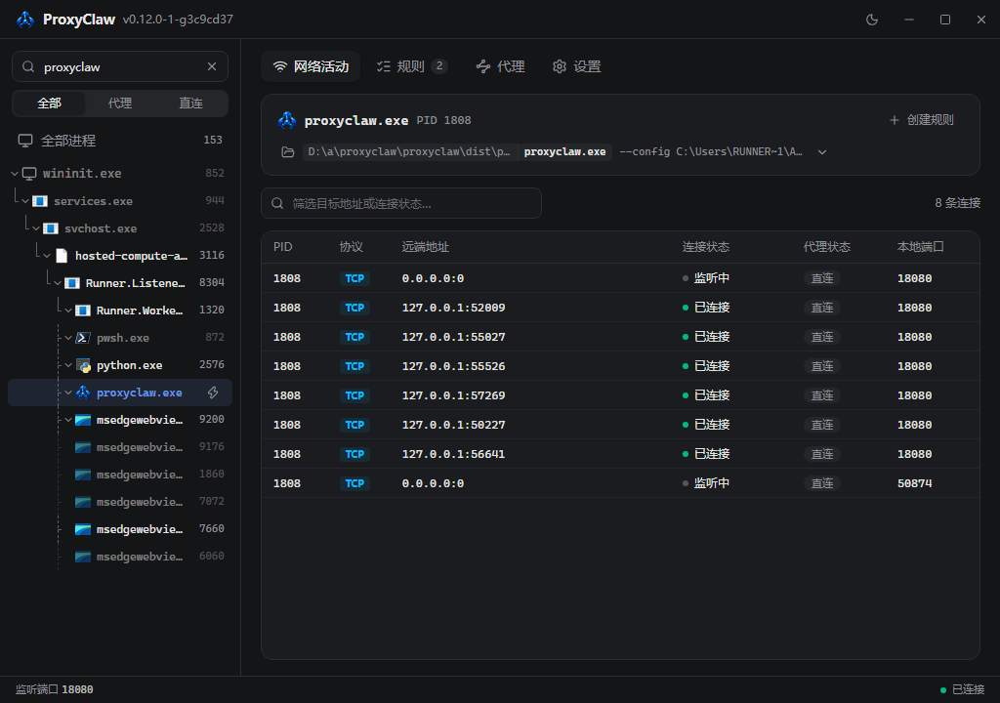
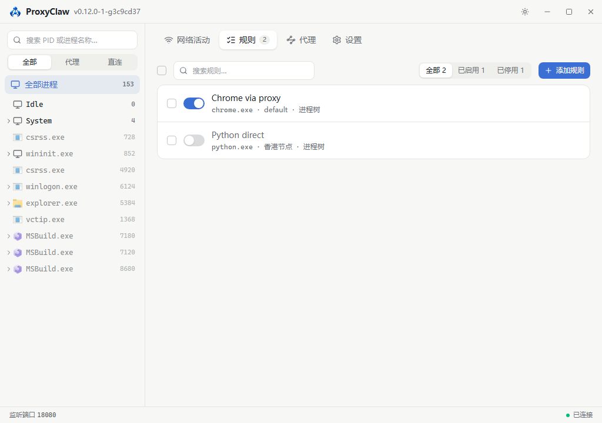
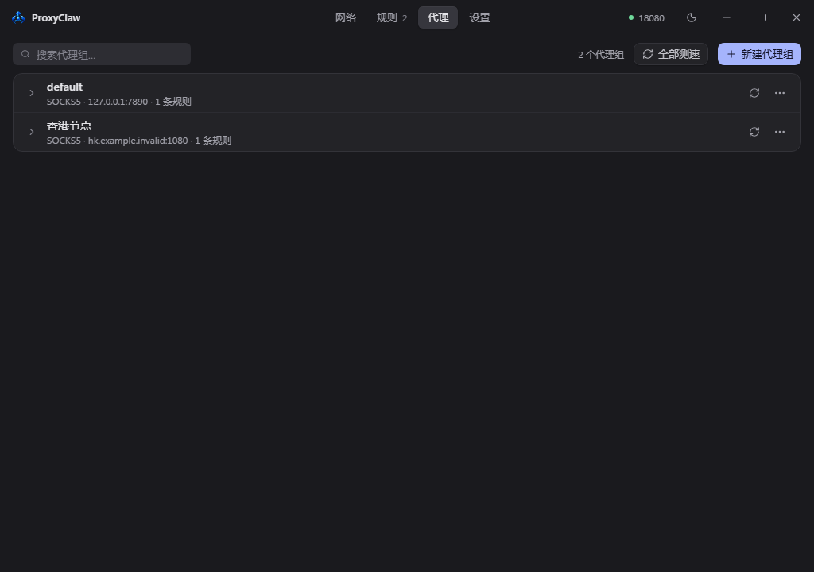
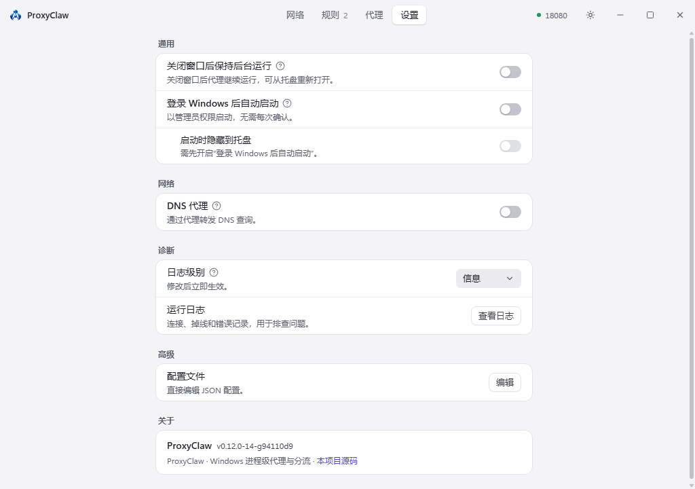

<div align="center">


# ProxyClaw

**Send only the programs you choose (and their whole child-process tree) through a SOCKS5 proxy. Everything else stays direct, no system-wide TUN.**

[](https://github.com/906222304/proxyclaw/releases/latest)
[](https://github.com/906222304/proxyclaw/releases)
[](https://github.com/906222304/proxyclaw/actions/workflows/release.yml)
[](#download--quick-start)
[](LICENSE)

[简体中文](README.md) · **English**



</div>

## Features

- **Process-level proxy without TUN**: WinDivert rewrites the chosen processes' connections in user mode and hands them to a local SOCKS5 relay. Unmatched traffic stays direct; system routes are untouched.
- **Process-tree proxying**: once a rule matches, every child the process spawns later follows it. Built for multi-process apps such as Chromium and Electron.
- **Rules**: match by process-name wildcard or exe path plus command-line keywords; TCP only / UDP only / both; refine with direct CIDRs, direct ports, proxy-only CIDRs and proxy ports. The UI's proxy state and the actual forwarding use the same decision.
- **Proxy groups and speed test**: several SOCKS5 back ends, routed per rule; a staged speed test (resolve, connect to proxy, SOCKS5 handshake, connect to target, first byte) shows where a failure happened. Proxy hosts may be IPv4, IPv6 or a domain name.
- **DNS proxy (optional)**: system DNS points to a built-in forwarder that queries the upstream over SOCKS5, retries over TCP on UDP timeout or truncation, and restores system DNS on exit or after a crash.
- **UDP**: forwarded with SOCKS5 UDP ASSOCIATE; each datagram keeps its own destination, and replies carry the correct source address.
- **Everyday comfort**: Chinese UI, dark and light themes, tray mode, silent start at login (Task Scheduler, no UAC prompt), built-in log viewer.

<table>
  <tr>
    <td></td>
    <td></td>
    <td></td>
  </tr>
</table>

## Download & quick start

Requirements: Windows 10 2004+ / Windows 11 (x64), administrator rights (the WinDivert driver and system DNS need them), WebView2 Runtime (bundled with Windows 11).

1. Download `proxyclaw-vX.Y.Z-windows-x64.zip` (with `.sha256`) from [Releases](https://github.com/906222304/proxyclaw/releases/latest) and **extract all files**. If you want autostart, extract to `C:\Program Files\ProxyClaw` (needs administrator rights).
2. Run `proxyclaw.exe` and accept the UAC prompt.
3. On **Proxies**, point the `default` group at your SOCKS5 (e.g. Clash at `127.0.0.1:7890`); on **Rules**, add a rule and **switch it on** (new rules start disabled).

Config lives in `proxyclaw.json` next to the exe (an old `clew.json` is imported once and left untouched); logs go to `proxyclaw.log`.

## Usage

- **Auto rules**: Rules → Add rule. Command-line keywords are space-separated, case-insensitive and order-free; e.g. process `node.exe` + keyword `ccusage` proxies only the Node process running ccusage. Destination checks run in this order: global excluded CIDRs → direct CIDRs → direct ports → proxy-only CIDRs → proxy ports.
- **Proxy one process now**: hover it in the process tree and click the lightning icon; that PID and its later children are proxied (always TCP + UDP).
- **Network activity**: select a process to see live connections and their proxy state; hover 已忽略 ("ignored") for the reason. The header can open the exe folder, copy the command line, or start a new rule from that process.
- **DNS proxy**: Settings → DNS proxy, off by default. It changes system DNS, so it affects name resolution for the whole machine.
- **Background and autostart**: closing the window keeps ProxyClaw in the tray (quit from the tray menu). "Start after Windows login" registers the `ProxyClawAutoStart` scheduled task (it starts ProxyClaw elevated without a UAC prompt, so it can only be enabled from a folder only administrators can modify, e.g. `C:\Program Files\ProxyClaw` — see [Troubleshooting](docs/TROUBLESHOOTING.en.md)); toggle it again after moving the exe.

## How it works

The C++23 back end intercepts outbound TCP/UDP with WinDivert and maps packets to processes using an ETW-fed process tree. TCP is redirected to a local SOCKS5 relay (new connections are held until the decision is made, so the first packet is not missed); UDP goes per datagram through SOCKS5 UDP ASSOCIATE. The UI is a React front end in WebView2 talking to a `127.0.0.1`-only, session-token-protected local API. Only IPv4 traffic is taken over today; IPv6 goes direct.

See [ARCHITECTURE.md](docs/ARCHITECTURE.md).

## Build from source

Needs Visual Studio 2026 (or 2022, C++23), CMake 3.20+, Python 3.12+, Node.js 22.

```powershell
python scripts/prepare_release_deps.py      # pinned, checksum-verified deps (same as CI)
cmake --preset windows-vs2026               # use "windows" for VS 2022

cd frontend; npm ci; npm test; npm run build; cd ..

cmake --build --preset windows-vs2026
ctest --preset windows-vs2026
./build/Release/proxyclaw.exe
```

`python scripts/verify.py` runs frontend tests and build, native build, CTest, layering checks and e2e (add `--no-e2e` outside an admin shell). Packaging and releases: [RELEASE.md](docs/RELEASE.md) (Chinese).

## FAQ

See [Troubleshooting](docs/TROUBLESHOOTING.en.md). Please attach the relevant part of `proxyclaw.log` to issues.

## Roadmap

See [ROADMAP.md](docs/ROADMAP.md) (Chinese, with an English summary at the top).

## Credits

- [Clew](https://github.com/ymonster/clew-proxy) by [@ymonster](https://github.com/ymonster): ProxyClaw is based on [Clew v0.10.0](https://github.com/ymonster/clew-proxy/tree/v0.10.0); process-tree proxying and SYN parking come from it.
- [WinDivert](https://github.com/basil00/Divert): makes user-mode per-process forwarding possible.
- Other dependencies: [THIRD_PARTY_NOTICES.md](THIRD_PARTY_NOTICES.md).

<a href="https://github.com/906222304/proxyclaw/graphs/contributors">
  
</a>

## License

[MIT](LICENSE), keeping the original Clew copyright. The dynamically linked WinDivert is LGPL v3; its license is in `WinDivert-2.2.2-A/LICENSE`.
