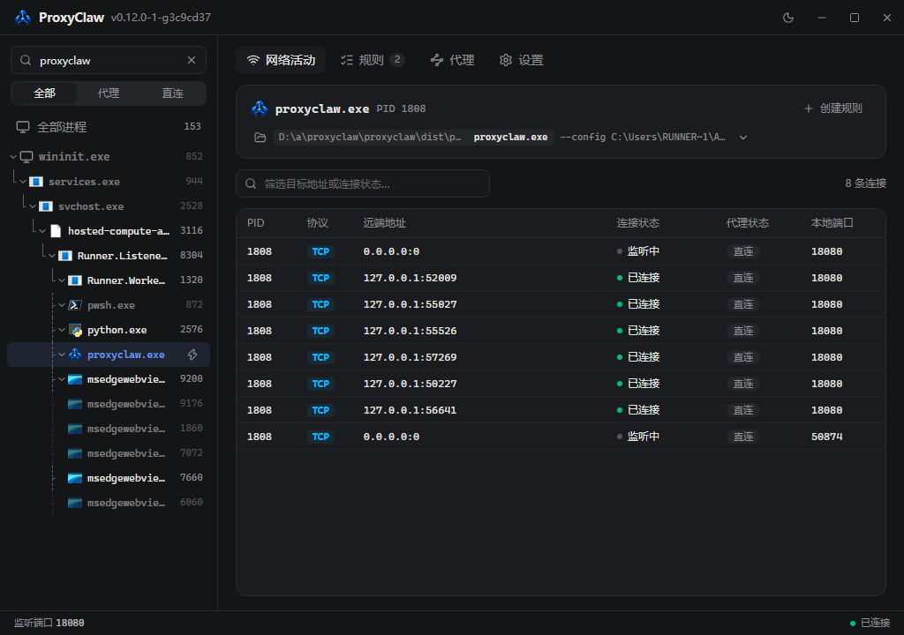
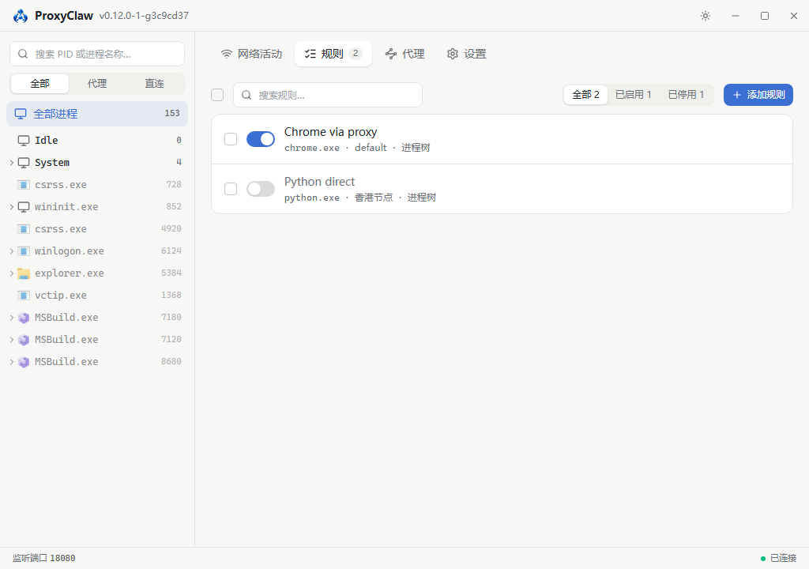
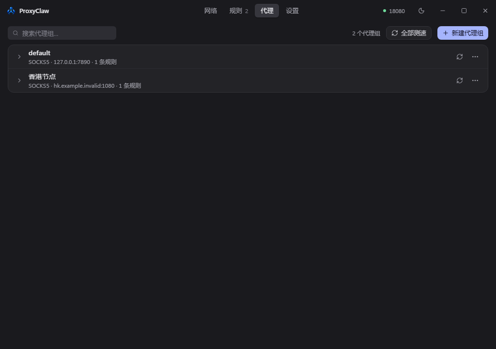
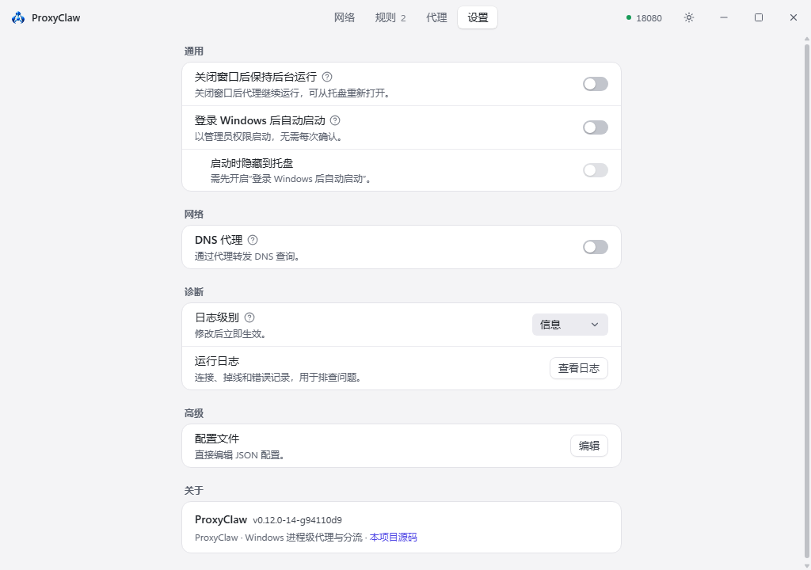

<div align="center">


# ProxyClaw

**只让指定的程序（连同它的整棵子进程树）走 SOCKS5 代理，其余流量照常直连，不用开全局 TUN。**

[](https://github.com/906222304/proxyclaw/releases/latest)
[](https://github.com/906222304/proxyclaw/releases)
[](https://github.com/906222304/proxyclaw/actions/workflows/release.yml)
[](#下载与快速开始)
[](LICENSE)

**简体中文** · [English](README.en.md)



</div>

## 特性

- **进程级代理，无需 TUN**：基于 WinDivert 在用户态改写指定进程的连接，交给本地 SOCKS5 中转；未命中的流量保持直连，不改系统路由。
- **进程树代理**：规则命中后，该进程之后派生的所有子进程自动跟着走代理，适合 Chromium / Electron 这类多进程应用。
- **规则**：按进程名通配符或 exe 路径、命令行关键词匹配；可选仅 TCP / 仅 UDP / TCP + UDP，并按直连网段、直连端口、仅代理网段、代理端口细分。界面上的“代理状态”与实际转发使用同一套判定。
- **代理组与测速**：多个 SOCKS5 后端，不同规则走不同组；分阶段测速（解析、连接代理、SOCKS5 握手、连接目标、首字节），失败时标出卡在哪一步。代理地址支持 IPv4、IPv6 和域名。
- **DNS 代理（可选）**：系统 DNS 指向内置转发器，查询经 SOCKS5 发往上游；UDP 超时或截断时改走 TCP；退出或被强杀后自动恢复系统 DNS。
- **UDP**：通过 SOCKS5 UDP ASSOCIATE 转发，每个数据包保留自己的目的地址，回包来源地址正确。
- **日常好用**：中文界面、深浅色主题、托盘常驻、开机静默启动（任务计划程序，无 UAC 弹窗）、内置日志查看器。

<table>
  <tr>
    <td></td>
    <td></td>
    <td></td>
  </tr>
</table>

## 下载与快速开始

系统要求：Windows 10 2004+ / Windows 11（x64）、管理员权限（WinDivert 驱动与系统 DNS 都需要）、WebView2 Runtime（Windows 11 自带）。

1. 从 [Releases](https://github.com/906222304/proxyclaw/releases/latest) 下载 `proxyclaw-vX.Y.Z-windows-x64.zip`（附 `.sha256`），**完整解压**。想用开机自启的话，建议解压到 `C:\Program Files\ProxyClaw`（需要管理员权限）。
2. 双击 `proxyclaw.exe`，同意 UAC 提权。
3. 在“代理”页把 `default` 组指向你的 SOCKS5（如 Clash 的 `127.0.0.1:7890`），再到“规则”页添加规则并**打开开关**（新规则默认停用）。

配置保存在同目录的 `proxyclaw.json`（首次运行会导入旧的 `clew.json`，原文件不动），日志写入 `proxyclaw.log`。

## 使用

- **自动规则**：“规则 → 添加规则”。命令行关键词用空格分隔，大小写不敏感、顺序无关，例如进程 `node.exe` + 关键词 `ccusage`，只代理运行 ccusage 的那个 Node。目标判定顺序：全局排除网段 → 直连网段 → 直连端口 → 仅代理网段 → 代理端口。
- **临时代理某个进程**：在左侧进程树悬停，点击闪电图标，即代理该 PID 及其之后的子进程（固定 TCP + UDP）。
- **网络活动**：选中进程查看实时连接与代理状态；悬停“已忽略”可看到原因。顶部信息条可打开 exe 所在目录、复制命令行，或以该进程为蓝本新建规则。
- **DNS 代理**：“设置 → DNS 代理”，默认关闭。会修改系统 DNS，影响整台电脑的解析。
- **后台与自启**：关闭窗口后默认留在托盘，右键托盘“退出 ProxyClaw”才结束；“登录 Windows 后自动启动”注册 `ProxyClawAutoStart` 计划任务（以管理员权限、无 UAC 提示启动，因此只允许从只有管理员能修改的文件夹开启，例如 `C:\Program Files\ProxyClaw`，见[排查文档](docs/TROUBLESHOOTING.md)），移动程序后需重新打开一次该开关。

## 工作原理

C++23 后端用 WinDivert 拦截出站 TCP/UDP，结合 ETW 维护的进程树判断包属于哪个进程：TCP 被重定向到本地 SOCKS5 中转（新连接在判定完成前暂存，避免首包漏掉），UDP 按包经 SOCKS5 UDP ASSOCIATE 转发。界面是 WebView2 中的 React 前端，通过只监听 `127.0.0.1` 且带会话令牌的本地 API 与后端通信。目前只接管 IPv4 流量，IPv6 直连。

详见 [架构文档](docs/ARCHITECTURE.md)。

## 从源码构建

需要 Visual Studio 2026（或 2022，C++23）、CMake 3.20+、Python 3.12+、Node.js 22。

```powershell
python scripts/prepare_release_deps.py      # 拉取并校验固定版本依赖（与 CI 一致）
cmake --preset windows-vs2026               # VS 2022 用 windows

cd frontend; npm ci; npm test; npm run build; cd ..

cmake --build --preset windows-vs2026
ctest --preset windows-vs2026
./build/Release/proxyclaw.exe
```

`python scripts/verify.py` 一次跑完前端测试与构建、后端构建、CTest、分层检查和 e2e（规则策略 `tests/e2e_rule_policy.py` 与管理 API `tests/e2e_api_test.py`；非管理员终端加 `--no-e2e`），加 `--stress` 再跑约 1 分钟的压力冒烟 `tests/stress_backend.py --ci`。CI 对打包产物运行同样的 API e2e 与压力冒烟，并上传 `stress-summary` 工件。打包与发布流程见 [RELEASE.md](docs/RELEASE.md)。

## 常见问题

见 [常见问题排查](docs/TROUBLESHOOTING.md)。提交 Issue 时请附上 `proxyclaw.log` 的相关片段。

## 路线图

见 [ROADMAP.md](docs/ROADMAP.md)。

## 致谢

- [Clew](https://github.com/ymonster/clew-proxy) by [@ymonster](https://github.com/ymonster)：ProxyClaw 基于 [Clew v0.10.0](https://github.com/ymonster/clew-proxy/tree/v0.10.0) 开发，进程树代理、SYN parking 等核心能力来自这里。
- [WinDivert](https://github.com/basil00/Divert)：让用户态进程级转发成为可能。
- 其它依赖见 [THIRD_PARTY_NOTICES.md](THIRD_PARTY_NOTICES.md)。

<a href="https://github.com/906222304/proxyclaw/graphs/contributors">
  
</a>

## License

[MIT](LICENSE)，保留 Clew 原作者版权。动态链接的 WinDivert 使用 LGPL v3，许可证见 `WinDivert-2.2.2-A/LICENSE`。
