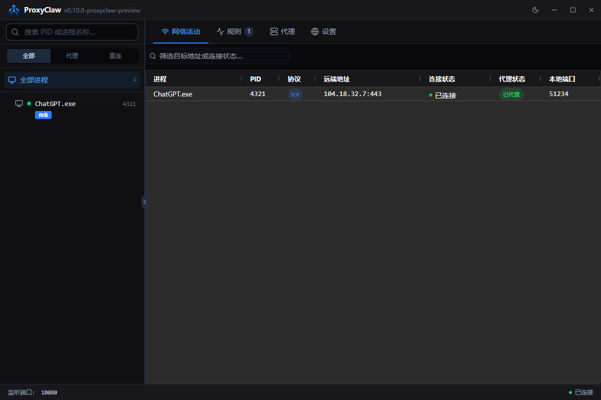
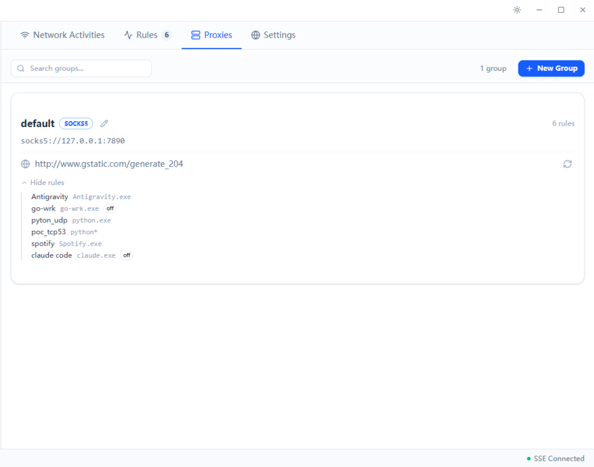
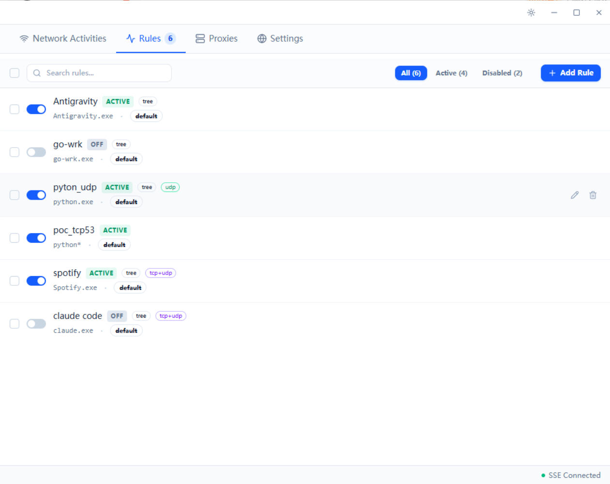
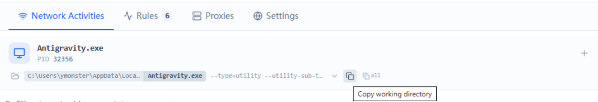

# ProxyClaw


> 代理爪 · Windows 进程级代理与分流

**Languages**: [简体中文](README.md) · [English](README.en.md)

基于 [Clew v0.10.0](https://github.com/ymonster/clew-proxy/tree/v0.10.0) 开发，保留原作者版权及 [MIT 许可证](LICENSE)。本项目加入中文界面、默认后台运行、DNS 生命周期修复和 UDP 超时后的 TCP 回退。

首次运行会将程序同目录的旧 `clew.json` 导入为 `proxyclaw.json`，原文件保持完整。新配置优先；显式指定其他名称的配置文件不会自动导入。日志为 `proxyclaw.log`，Windows 自动启动任务名为 `ProxyClawAutoStart`。



---

## 简介

一个跑在 Windows 上的进程级流量代理工具。

做它的起因是很早前用 Antigravity 时发现：后端 Clash 不开 TUN mode 甚至无法刷新模型列表，开了又影响其它应用。我不想为了一个软件全局劫持流量，就做了个工具让特定进程独立走代理，一直到现在这个版本。

## 特性

- **进程树代理**：一条规则命中后，它的所有子进程（包括启动后才动态派生的）会自动跟着走代理。Chromium / Electron 类应用会派生很多子进程，只代理主进程通常不够，或者你需要做足够的研究才能知道究竟需要代理哪个进程。那么现在你可以在 “规则” 页面去增加规则，选择特定 image path 的 exe 文件，也可以只输入一个名字（比如 Antigravity.exe），都可以完成任务。
- **命令行级别匹配**：比如同一个 `python.exe` 跑不同脚本时， “规则” 页面配置你的规则时，可以用命令行关键词进行匹配（比如只代理跑 `crawler.py` 的那个进程，不影响其它 python 进程）。
  - 比如 [ccusage](https://github.com/ryoppippi/ccusage)，跑的时候会报 `Failed to fetch model pricing from LiteLLM`。Node 24 以上可以用 `NODE_USE_ENV_PROXY=1` 让 HTTP 代理环境变量生效；也可以用 ProxyClaw 在“规则”页面新增规则，规则名称填 `ccusage`，进程名称填 `node.exe`，**命令行匹配填 `ccusage`**，问题就解决了。

- **多 SOCKS5 后端**：支持多组代理，不同规则路由到不同组。因为我用到的大多数代理服务工具都支持 socks5，而 http 代理这些工具自身就支持，不需要我来做。
- **UDP 支持**：per-app-port SOCKS5 UDP ASSOCIATE，基于 RFC 1928。
- **内置 DNS forwarder**：启用后把系统 DNS 自动指向 ProxyClaw 的内置 forwarder，DNS 查询走 SOCKS5 到上游；关闭或退出会还原系统 DNS，异常被强杀，下次启动也会检测残留并恢复。
- **UI 即时响应**：v0.8.1 及之前 hack / unhack 等操作偶尔会卡几秒；这版分开修了两个互不相关的成因：
  - **状态推送改走 WebView2 进程内 IPC**：原先用 HTTP/SSE 推送，SSE 长连接会占住 HTTP/1.1 同源 6 连接里的一个槽位，并且 chunked 字节流的解码常驻 V8 主线程；换成 `PostWebMessageAsJson` 后推送不再走浏览器网络栈，连接池和 V8 都松快了。
  - **DELETE 请求显式带 `body: ''`**：cpp-httplib 把所有 DELETE 当作"可能有 body"，没看到 Content-Length 时会 peek 等满 5 秒 `read_timeout` 才把请求交给 handler；浏览器 fetch DELETE 默认不发 Content-Length，结果一次 unhack 死等 5 秒。前端在 DELETE 请求里显式带空 body 让浏览器写出 `Content-Length: 0`，cpp-httplib 走快路立即处理。

## 这个工具适不适合我

**适合**

- 你想让某个app走代理，但它可能不只有http访问，也有tcp/udp访问，同时你完全不知道或者不想知道到底是哪个子进程做了网络活动。
- 已经有 Clash 这类代理服务客户端在跑，只想让几个特定应用走它，不想开全局 TUN。
- 在意 MIT 许可证，要集成进内部工具链或商业产品而不沾 AGPL 传染风险。

**不适合**

- 需要 macOS / Linux → 看 [ProxyBridge](https://github.com/InterceptSuite/ProxyBridge)
- 只要命令行不要 GUI → 看 [ProxiFyre](https://github.com/wiresock/proxifyre)

## 安装与运行

### 系统要求

- Windows 10 版本 2004 或更新 / Windows 11
- 管理员权限（WinDivert 驱动和系统 DNS 配置都需要）
- [VS2022 C++ 运行时](https://aka.ms/vs/17/release/vc_redist.x64.exe)
- WebView2 Runtime（Windows 11 自带；Windows 10 从 [微软](https://developer.microsoft.com/microsoft-edge/webview2/) 下载）

### 下载

使用本项目构建的 Windows x64 压缩包，解压后双击 `proxyclaw.exe`，会自动弹 UAC 提权。源码构建步骤见下文。

## 使用

### 中文界面与后台运行

- 界面、进程状态、规则编辑器及托盘菜单采用简体中文，并适配 Windows 中文字体。
- 新配置默认开启“关闭窗口后保持后台运行”：关闭主窗口后代理仍在运行，点击托盘图标可重新打开窗口；右键托盘选择“退出 ProxyClaw”才会结束程序。
- “设置 → 通用设置”中的后台运行开关保存后立即生效。已有配置明确设置 `ui.close_to_tray: false` 时仍遵循该设置，可手动开启。
- 托盘暂时不可用时保留任务栏入口；托盘注册多次失败时重新显示窗口，避免无法操作后台程序。
- 开机启动需自行开启；需要登录后直接在后台运行时，同时开启“启动时隐藏到托盘”。

### 1. 配置代理后端

“代理”标签页

- 默认已经有一个 `default` 组，改 host / port 指向你的 SOCKS5（比如 Clash 的 `127.0.0.1:7890`）。
- 点击刷新图标可以进行延迟测试



### 2. 添加自动规则

“规则”标签页

- 点击“添加规则”可以新增规则，新建规则默认停用，要手动打开开关才会生效
  - **规则名称**：规则名
  - **进程名称**：通配符，例如 `curl*`、`python.exe`
  - **命令行匹配**：命令行关键词（多关键词空格分隔，大小写不敏感，顺序无关）
  - **代理整个进程树**：始终开启，子进程也跟着代理
  - **协议**：仅 TCP / 仅 UDP / TCP + UDP
  - **代理组**：走哪个代理组
- 可以查看当前的规则列表和状态



### 3. 进程树和网络活动

- **Process Tree**：进程树。hover 某个进程，右侧会出现一个小闪电图标，点击即可代理当前这个 PID（含它未来派生的子进程）。适合临时调试。**手动 hack 默认同时代理 TCP + UDP，不可选协议**；如果只想代理单一协议，请用 Auto Rule 的 `Protocol` 字段。

  

- **全部进程**：点击左侧 “全部进程”（或不选中任何特定进程）可以看到所有进程的实时网络活动。
- **网络活动进程头**：选中某个进程后，上方会出现这个进程的详细信息条。
  - **定位**：进程名左侧 explorer 图标可以定位进程所在目录
  - **复制信息**：路径栏 hover 会出现两个复制图标，左侧复制的是 working directory，右侧“全部” 复制连同 image path 在内的完整 cmdline
  - **从进程增加规则**：右侧 `+` 图标可以以此进程为蓝本新增一条规则

  

### 4. DNS 代理（默认关闭）

部分应用（Spotify、某些海外服务）对 DNS 解析的地域敏感。设置 → DNS 代理 打开后：

- 把系统 DNS 自动配置成 127.0.0.2（ProxyClaw 内置 forwarder）
- DNS 查询走 SOCKS5 到上游（默认 8.8.8.8）
- 关闭 / 退出自动还原系统 DNS；异常退出下次启动会检测残留并恢复

### 5. 开机自动启动（默认关闭）

ProxyClaw 运行需要管理员权限（驱动级流量拦截）。如果走注册表 `HKCU\Software\Microsoft\Windows\CurrentVersion\Run`，每次开机会弹 UAC 确认窗口，体验差。所以选择 Windows 任务计划程序（Task Scheduler）+ "以最高权限运行"，登录后静默以管理员身份启动，无 UAC 提示。

设置 → “登录 Windows 后自动启动” 打开后：

- 自动注册一个名为 `ProxyClawAutoStart` 的登录任务（`schtasks /Create /SC ONLOGON /RL HIGHEST`）
- 子选项 "Start minimized to tray"：勾选则任务命令行附加 `--minimized`，启动后只显示托盘图标，不弹主窗口
- 关闭开关 = 删除任务（`schtasks /Delete /F`）；任务计划程序 GUI 里手动删除也会被“设置”页实时检测到

注意：任务计划程序记录的是 `proxyclaw.exe` 的绝对路径。如果之后挪动了 `proxyclaw.exe`，请重新打开此开关让任务指向新路径。

## 技术选择

### 第三方库

后端：

- [WinDivert](https://github.com/basil00/Divert) — Windows 下基于 WFP 的用户态抓包 / 转发库；动态链接，随 release 一起分发（LGPL v3）
- [quill](https://github.com/odygrd/quill) — 异步结构化日志
- [nlohmann/json](https://github.com/nlohmann/json) — JSON 解析和序列化
- [cpp-httplib](https://github.com/yhirose/cpp-httplib) — 内置 HTTP + SSE 服务端
- [asio](https://think-async.com/Asio/) — 异步 IO
- [WebView2](https://developer.microsoft.com/microsoft-edge/webview2/) — 嵌入 Edge 渲染前端 UI

前端：

- [Vue 3](https://vuejs.org/) + TypeScript + [Vite](https://vitejs.dev/) — 应用框架和构建
- [reka-ui](https://reka-ui.com/)（shadcn-vue 风格） + [Tailwind CSS](https://tailwindcss.com/) — 组件 + 样式
- [AG Grid Community](https://www.ag-grid.com/) — Network Activities 表格
- [Monaco Editor](https://microsoft.github.io/monaco-editor/) — “设置”页里的 JSON 编辑器（懒加载）
- [Lucide](https://lucide.dev/) — 图标

完整许可见 [THIRD_PARTY_NOTICES.md](THIRD_PARTY_NOTICES.md)。

### 为什么用 WinDivert

- 成熟的 WFP callout driver，Win10/11 稳定支持
- LGPL v3 允许动态链接 `.dll`，主项目可以保持 MIT
- **免费**：WinDivert 作者已经付了 kernel driver 签名费用，发布的就是签好的 .sys

### 为什么现在不用 DLL 注入路线

1. 尝试过注入 `GetAddrInfoW` 效果不错，但现在有很多自带异步 DNS resolver 的进程无法覆盖。所以需要同时注入 `getaddrinfo` / `GetAddrInfoW` / `connect` / `WSAConnect` / `ConnectEx` 等网络相关调用，工程量稍大。
2. 使用 `PsSetCreateProcessNotifyRoutineEx` 可以更准确地发现进程的创建和销毁，结合网络层能更准确地拦截网络操作，注入等动作会更准确和高效。
3. 但以上技术在我本机测试中可行，实际环境中需要考虑安全软件，需要通过 SignPath 这类服务签名，以及适配各种安全软件等一系列操作，本身周期就很长，甚至可能需要付费。
4. 结论：WinDivert 目前够用，但如果有相应需求可以单开 branch 尝试 DLL 注入。

### 为什么不做自研 WFP kernel driver

技术上更完善（`FWPM_LAYER_ALE_CONNECT_REDIRECT_V4` 直接改 socket 目标、零包操作），但有一个非常关键的问题： Windows 10+ 要求 kernel driver 必须由 Microsoft 签名，走 Partner Center 需要一张 EV code signing 证书（约 300–600 美元 / 年）和 attestation 流程，成本过高。

### 进程树更新策略（`PROXYCLAW_PROJECTION_COALESCE`）

默认每个 ETW 进程事件直接刷新前端、即时推送，不做 timer 合并。常规使用——即使 1000+ 进程在跑——完全没问题，strand 利用率不到 1%。只有**瞬间 +1000 进程的 ETW 风暴**（比如某个工具一次 fork 出几千个子进程）才可能让 strand 短时间被序列化负担占住；UI 上常用的"看某个特定进程"这类操作即使在风暴期间也不会被影响。如果遇到这类极端工作负载且需要进一步缓解，可以编译时打开 `cmake -DPROXYCLAW_PROJECTION_COALESCE=ON` 启用 100ms 合并窗口（代价：树更新最多滞后 100ms）。

## 构建

### 构建工具链

- Visual Studio 2022（C++23）
- CMake 3.20+
- vcpkg
- Node.js 20+
- WebView2 SDK

### 步骤

```bash
# 配置
cmake --preset windows-vcpkg

# 后端（refactor 之后 TU 数量从 2 个涨到 ~30 个，首次 clean build 会比 legacy 版本慢一些；
# CMakeLists 已开启 /MP 并行编译，多核机器明显缓解）
cmake --build build --config Release

# 前端
cd frontend
npm install
npm run build
cd ..

# 运行
./build/Release/proxyclaw.exe
```

### DNS UDP 超时后的 TCP 回退

DNS 代理优先使用 SOCKS5 UDP 转发。单条请求在 1.5 秒内未收到有效回复时，通过同一个 SOCKS5 代理向原上游 DNS 服务器建立 TCP 连接并重试；UDP 回复设置了截断标志（TC）时立即重试。

TCP 阶段的解析代理地址、连接、SOCKS5 握手、发送及接收共享 3 秒超时，失败后向客户端返回 `SERVFAIL`。有效的迟到 UDP 回复可结束重试，每条请求只返回一次；请求编号会重新分配并在回复时还原，避免不同进程的同编号请求串线。

本地接口仍监听 UDP；返回报文遵循客户端的 EDNS UDP 容量，超过容量时返回 TC 截断回复。本地 TCP DNS 接入不在此次改动中。

TCP 封装和 SOCKS5 回复读取分别遵循 [RFC 7766](https://www.rfc-editor.org/rfc/rfc7766.html) 和 [RFC 1928](https://www.rfc-editor.org/rfc/rfc1928.html)。

### 界面加载与后台刷新回归测试

本次优化及后续建议见 [项目优化检查](docs/OPTIMIZATION_REVIEW.md)。设置页的高级 JSON 编辑器按需加载；周期刷新等待上次请求结束，隐藏或切换进程时取消旧请求。窗口恢复后主动同步进程树。

```powershell
node --test tests/async_poller_test.mjs
python tests/run_projection_tests.py --cxx path/to/zig.exe --asio-include path/to/asio/include
```

### 高清屏窗口回归测试

Windows 窗口使用 PerMonitorV2 DPI 适配，WebView2 跟随屏幕和系统文字缩放；切换屏幕时调整窗口、最小尺寸及图标。已保存的窗口位置和大小保持物理像素格式兼容。

进程列表的图标从程序资源提取为 64×64 PNG 缓存，避免把 16×16 图片直接放大到高 DPI 屏幕。

下面的检查仅创建短暂隐藏的测试窗口，验证嵌入的 DPI 声明、屏幕工作区、最小窗口尺寸及 100%/125%/150%/200% 的缩放事件与图标加载，并验证真实图标提取及 PNG 尺寸，不启动代理、不修改 DNS。缩放事件采用模拟消息，多屏实际拖动仍需人工验证。

```powershell
python tests/run_window_dpi_tests.py --cxx path/to/zig.exe
```

### DNS 生命周期与报文解析回归测试

中文路径、后台默认值及旧配置导入可单独验证（仅操作 `build` 内的测试文件，不启动代理）：

```powershell
python tests/run_ui_config_tests.py --cxx cl --json-include C:/vcpkg/installed/x64-windows/include
# Zig 示例（指定包含 nlohmann/json.hpp 的目录）
python tests/run_ui_config_tests.py --cxx path/to/zig.exe --json-include build/test-deps
```

下面的测试直接编译 DNS 管理器，用替代的网络和 Windows 接口模拟启动、重启、备份及恢复失败，并检查 DNS 报文、压缩指针及 EDNS 大小解析。不需要管理员权限、WinDivert 驱动、运行中的代理或 vcpkg，也不会改动系统 DNS。

```powershell
# VS2022 开发者终端
python tests/run_dns_tests.py --cxx cl

# 或使用 Clang / Zig C++ 编译器
python tests/run_dns_tests.py --cxx clang++
python tests/run_dns_tests.py --cxx path/to/zig.exe
```

### DNS 真实网络回归测试

在 Windows 上编译生产 DNS 转发器与 SOCKS5 UDP 会话，以本机模拟代理验证 UDP 超时、TCP 分段读取、不同类型的 SOCKS5 回复、失败和超时、并发编号冲突、迟到回复及停止清理。仅使用回环地址，不修改系统 DNS。

```powershell
python tests/run_dns_network_tests.py --cxx cl --asio-include path/to/asio/include
# 或使用 Zig
python tests/run_dns_network_tests.py --cxx path/to/zig.exe --asio-include path/to/asio/include
```

### 中文路径与后台默认值回归测试

`tests/test_ui_config_and_paths.cpp` 在 Windows 上检查中文文件选择、UTF-8/UTF-16 转换、特殊 Unicode 字符及后台运行默认值。文件选择器和 Explorer 调用由替代接口模拟，不会打开真实窗口。

```powershell
# 将 nlohmann/json.hpp 所在的 include 目录替换为本机路径
zig c++ -std=c++23 -Isrc -Ibuild/test-deps tests/test_ui_config_and_paths.cpp src/common/api_exception.cpp -lshell32 -lws2_32 -o build/test_ui_config_and_paths.exe
./build/test_ui_config_and_paths.exe
```

### clangd / LSP 配置（可选）

仓库里有 `.clangd` 文件和 `windows-vcpkg-clangd` preset，**只编译跑 release 用不到**，可以无视。

只有编辑器用 clangd 做跳转 / 补全（VS Code clangd 插件、Visual Studio clangd 插件、vim/neovim/helix、Claude Code 自带 LSP 等）的人才用得上。原因：CMake 的 Visual Studio 生成器不输出 `compile_commands.json`，clangd 拿不到 vcpkg / WebView2 / asio 这些头文件的 include 路径，会一片红。`.clangd` 配合一个独立的 Ninja preset 喂给 clangd 完整的 include。

启用步骤（需要本机有 Ninja）：

```bash
cmake --preset windows-vcpkg-clangd
```

会在 `build-clangd/` 下生成 `compile_commands.json`（已 gitignore），clangd 自动读取。改了 `vcpkg.json` / 加了源文件 / 加了 include 目录后重跑一次。

## 贡献

欢迎 Issue / PR。项目结构、架构说明、API schema 见 [docs/ARCHITECTURE.md](docs/ARCHITECTURE.md)。

## License

- ProxyClaw：[MIT](LICENSE)
- 动态链接的 [WinDivert](https://github.com/basil00/Divert)：LGPL v3（原许可证保留于 `WinDivert-2.2.2-A/LICENSE`）
- 其它第三方依赖许可：见 [THIRD_PARTY_NOTICES.md](THIRD_PARTY_NOTICES.md)
