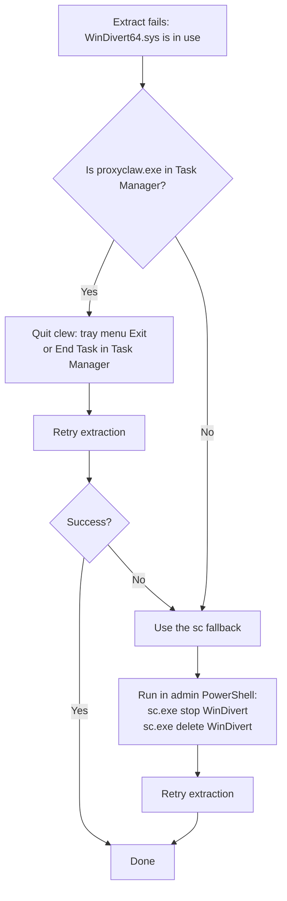

# Troubleshooting

> **Languages**: [简体中文](TROUBLESHOOTING.md) · [English](TROUBLESHOOTING.en.md)

Ordered by how often users actually hit the issue, most common first.

---

## 1. Double-clicking does nothing / no UAC prompt appears

**Symptom**: A black window flashes and disappears, or nothing happens at all.

**Causes** (in order of likelihood):

1. **Not logged in as administrator**: ProxyClaw can't elevate via RunAs; the current Windows account itself needs admin privileges. Run `whoami /groups | findstr "S-1-5-32-544"` in a terminal to confirm.
2. **WebView2 Runtime not installed**: built into Windows 11 and recent Windows 10; download the [Evergreen Standalone Installer from Microsoft](https://developer.microsoft.com/microsoft-edge/webview2/) on stripped-down or offline systems. Since v0.13.1, if the window cannot be created a dialog shows the address to open the UI in a browser; the proxy keeps running until you close that dialog (earlier versions quit after one hour).
3. **UAC disabled by group policy**: check `Control Panel → User Accounts → Change User Account Control settings` — don't set it to "Never notify". Especially relevant on domain-joined machines.

**To diagnose**: right-click `proxyclaw.exe` → "Run as administrator". If it still flashes and dies, open `Event Viewer → Windows Logs → Application` and look at the latest Application Error entry — it'll show the crashing module.

## 2. UI starts but proxy is not working

**Symptom**: UI is up, you've added a rule, but the target app's traffic still goes direct.

**Walk through these checks in order**:

1. **Is the rule toggle ON?** New rules default to OFF — you need to flip the switch on. The Rules page shows the state.
2. **Does the SOCKS5 backend actually work?** Each proxy group has a latency-test button (the small refresh-style icon). Use it to verify the backend is reachable. A failure names the stage: "connect" means the proxy is not listening at that host/port; "handshake" usually means it wants authentication or is not SOCKS5; "remote" means the proxy works but cannot reach the test URL.
3. **Process matched but traffic doesn't go through proxy**:
   - Check the `Protocol` field on the rule. If it's TCP only, UDP traffic won't be proxied; pick `Both` for full coverage.
   - Is the destination on a local / loopback network? By design `default_exclude_cidrs` excludes 127/8 + 10/8 + 172.16/12 + 192.168/16 + 169.254/16, so traffic to those ranges stays direct (avoids breaking local services). To proxy a specific intranet range, edit `default_exclude_cidrs` to remove that CIDR.
4. **Short-lived processes (git / curl / gh) work only sometimes**: before v0.10 their first connection nearly always escaped (the process connects ~150 ms after birth; ETW announces it 1–2 s later). Since v0.10 the SOCKET layer resolves the process synchronously and the NETWORK layer holds the connection's first SYN until the decision lands ("SYN parking"). Check `tcp_syn_parking` in `GET http://127.0.0.1:18080/api/stats` (since v0.10.2 the API needs a session token: start ProxyClaw with `PROXYCLAW_API_TOKEN=<32+ random chars>` and the `--dev-hooks` argument — since v0.13.1 release builds read that variable only with `--dev-hooks` — then run `curl -H "X-ProxyClaw-Token: <same value>" http://127.0.0.1:18080/api/stats`):
   - `parking.released_by_watchdog` and `socket.late_rejected_proxied` keep growing = decisions arrive too late and the proxy is missing flows. Set `log_level` to `debug` and look at the `[TreeMgr] Sync-resolved … in Nus` timings around `[SYN-PARK] watchdog released`.
   - `parking.pool_in_use` does not return to 0 while nothing is connecting = pool leak; please report it with the log.
   - If you suspect parking itself broke a connection: add `"tcp_syn_parking": { "enabled": false }` to `proxyclaw.json` and restart. That restores the old behavior (short-lived processes escape again, but the new code is out of the picture). The log says `[SYN-PARK] disabled by config`.

## 3. WinDivert64.sys locked when upgrading

**Symptom**: Extracting a new version's zip fails with "file in use, cannot replace `WinDivert64.sys`".

**Why**: The driver is a kernel-mode service (service name = `WinDivert`). Even if `proxyclaw.exe` exits, the service may not stop immediately on certain code paths (abnormal exit, installer race), and the file stays locked.

**Recovery flow**:



**sc commands** (admin PowerShell):

```powershell
sc.exe stop WinDivert
sc.exe delete WinDivert
```

The explicit `.exe` suffix avoids collision with PowerShell's built-in `Set-Content` alias. `delete` does **not** remove the `WinDivert64.sys` file from disk — it only unregisters the service from the SCM. The next `proxyclaw.exe` start re-registers it.

## 4. DNS resolution breaks after enabling DNS Proxy

**Symptom**: After turning on Settings → DNS Proxy, browsers and other apps can't resolve any DNS.

**What to do**:

1. **Normal path**: turn off Settings → DNS Proxy. ProxyClaw will automatically restore the original system DNS.
2. **ProxyClaw crashed before it could restore**: launch ProxyClaw again — it detects the leftover `dns_state.json` and restores the original DNS on startup.
3. **Can't get ProxyClaw running / never want to use this feature again**: reset DNS manually — `Control Panel → Network and Sharing Center → Change adapter settings → right-click your network adapter → Properties → IPv4 → Obtain DNS automatically`.

**Root cause to fix**: DNS Proxy startup failure is usually because the upstream is unreachable. `Settings → DNS Proxy → upstream` defaults to `8.8.8.8:53`. If your network blocks 8.8.8.8 (common in some regions), change it to `1.1.1.1:53` or your ISP's DNS.

## 5. Reading the log

**Location**: `proxyclaw.log` in the same directory as `proxyclaw.exe`.

**Verbosity**: Settings → Log Level → `debug` (default is `info`). Takes effect immediately, no restart needed.

**Common errors**:

| Keyword | Meaning | Usual cause |
|---|---|---|
| `WinDivertOpen failed` | Driver couldn't open | Not running as admin; driver not installed properly |
| `socks5 handshake failed` | Can't reach SOCKS5 upstream | Wrong host:port; backend not running; firewall blocking |
| `bind 18080 failed` | API port in use | Another ProxyClaw already running, or another program is bound to 18080 |
| `ETW session creation failed` | Process monitoring couldn't start | Not running as admin; rare same-named ETW session conflict |

## 6. Filing an issue

The most useful information to include:

1. ProxyClaw version (visible in the bottom-left corner of the UI)
2. Windows version (run `winver`, include the build number if possible)
3. Steps to reproduce — be specific about which button you clicked, which rule you added
4. The last 200 lines of `proxyclaw.log` (set log_level to `debug` and reproduce once before grabbing the log)
5. Whether the issue is reliably reproducible

[File an issue on GitHub](https://github.com/ymonster/clew-proxy/issues/new).

## 7. "Start after Windows login" cannot be turned on

**Symptom**: the switch in Settings is greyed out, or turning it on reports that the current folder can be modified by normal users; or it is already on and a yellow warning says the existing autostart task is an elevation risk.

**Why**: autostart uses a scheduled task that starts ProxyClaw elevated **without a UAC prompt**. If the folder containing `proxyclaw.exe` (or a DLL in it, the `frontend` UI files, or a parent folder) can be modified by unelevated programs, any program running under your account could replace those files and silently get administrator rights at your next logon. Since v0.13.1 autostart can only be enabled when those locations are modifiable exclusively by Administrators / SYSTEM / TrustedInstaller (`Downloads`, `Desktop` or a folder such as `D:\Tools` usually are not).

**Fix**:

1. Move the whole ProxyClaw folder (as administrator) to `C:\Program Files\ProxyClaw` — Program Files is admin-only by default.
2. Start ProxyClaw from the new location and turn the switch on. If an old task still points to the previous location, turn the switch off and on again to re-create it.
3. A folder of your own also works, provided it and its files are owned by Administrators (or SYSTEM / TrustedInstaller) and normal users only have read/execute rights. The warning names the exact file or folder and the account that has write access.

A task registered before the upgrade that points to an unsafe location is not deleted automatically, but Settings and `proxyclaw.log` warn about it; fix it as above.

## 8. PROXYCLAW_DEV_URL / PROXYCLAW_API_TOKEN / WEBVIEW2_* have no effect

Since v0.13.1 release builds **ignore** these developer/test environment variables and remove them from the process environment at startup (the log says `Ignoring environment variable …`). User environment variables can be changed without administrator rights while ProxyClaw runs elevated; these variables could send the session token to an arbitrary page, pre-select the API token, or open a debugging port into the embedded browser.

For development or test runs, add `--dev-hooks` to the **elevated** command line to restore the old behaviour, e.g. `proxyclaw.exe --dev-hooks`. Debug builds always honour them.

## 9. Console mode

Without a window (console build, or a debug build's console) ProxyClaw now keeps running until you press Ctrl+C or close the console; on exit it restores DNS before closing WinDivert. Earlier versions quit after one hour.
